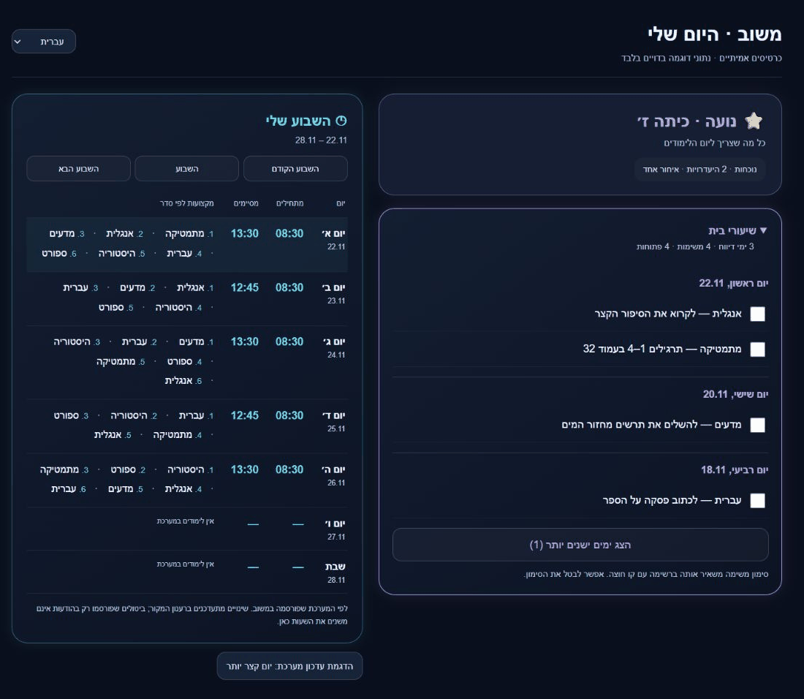

[← README](../README.md) · [Automation blueprints](blueprints.md) · [Services](services.md)

# Mashov Live dashboard

One‑click import (My Home Assistant):

[](https://my.home-assistant.io/redirect/blueprint_import/?blueprint_url=https%3A%2F%2Fraw.githubusercontent.com%2FNirBY%2Fha-mashov%2Fmain%2Fblueprints%2Fscript%2Fmashov%2Fmashov_live_dashboard.yaml)

## What it shows

- A weekly table of each child's subjects, first start time and last finish time, joined to that school's bell schedule. Holidays use the displayed week's actual dates. Missing bell times are marked; lesson numbers and subjects remain visible.
- A collapsible checklist for the last **three dates with homework**, including every assignment on those dates. **Show older days** reveals older assignments still in the fetched window. Checking a task strikes it through in place; unchecking reopens it.
- A greeting card with the current holiday countdown (or days until the next holiday) and a refresh button.
- One card per student with a steady neon accent, readable text, a live "tomorrow" line and homework/behavior/grade/notice counts. The selected Mashov profile picture is preferred, with the linked person's picture as a fallback.
- Separate cards for the school day, school-year absence/lateness totals, subjects and teachers, lesson counts and bell times. Subject and bell tables expand on demand; behavior, grades and notices have compact detail sections. Homework checklists and the school calendar remain available.
- Hebrew right‑to‑left layout, with English words and numbers kept left‑to‑right.

Embedded child-room sections use `student_room_cards`: tapping the child's name/photo opens their school summary; the message, grade, behavior and homework buttons open focused, readable pop-ups. Those topic dialogs show all stored records, with full homework text, instead of the raw sensor history.

Enable **Absence and lateness counters**, **Study groups**, **Lesson counters**, **School bells** and **Student pictures** under **Configure → Data to fetch** to show the new information. Each source is discovered by its stable registry identity, including renamed entities and separate school accounts. Unavailable data is explained instead of shown as zero; stale data and partial attendance rows are labeled. Attendance totals count lesson events, with justified/unjustified breakdowns and unclassified events reported separately.

The homework and weekly cards are bundled with Mashov and loaded automatically. Other detail cards use native Home Assistant Markdown. Optional **card-mod** adds dark panels, border glow and responsive table styling to those cards. The design has no flashing or animated glow. Re-run the dashboard script after changing selected data sources so newly enabled entities are discovered.

### Timetable updates and cancellations

The weekly table recalculates when the Mashov timetable or bell sensor updates. A lesson removed from the published timetable changes the day's start/end times. It does **not** currently interpret cancellation messages or connect to Shahaf/iScool. A cancellation published only in a message or in another app therefore does not change these hours. Check the readable messages for those announcements. No cancellation feed is implied by the demo.

The compact `weekly_schedule` attribute contains the full week independently of the raw sensor item limit. If it cannot fit or contains invalid slots, the card labels the week incomplete and does not calculate potentially misleading start/end times. Week-specific lessons are marked with an asterisk; a week-specific first or last lesson suppresses that boundary time until its week rules can be verified. Interior week-specific lessons do not hide definite start/end times.

### Homework configuration

The blueprint's **Recent homework days** input defaults to `3` and accepts `1–14`. It counts distinct assignment/report dates, not calendar days or due dates. Older dates remain accessible; the integration's configured homework fetch window determines how far back they go. Completion uses the existing `todo` entity's stable item IDs and survives browser refreshes and HA restarts. It stays local to HA and does not edit school records.

To embed the cards manually:

```yaml
type: custom:mashov-homework-card
entity: todo.example_homework_checklist
source_entity: sensor.example_homework
days: 3
collapsed: true
language: he
accent: '#b6a0ff'
```

```yaml
type: custom:mashov-weekly-card
entity: sensor.example_timetable
bells_entity: sensor.example_bells
holidays_entity: sensor.example_holidays
language: he
accent: '#5adcf0'
```

## Keeping the dashboard through upgrades

Saved UI dashboards belong to Home Assistant's persistent configuration (`.storage/lovelace*`), outside `custom_components/mashov`. Mashov setup, reloads and upgrades do not regenerate them. Only an explicit `mashov.create_live_dashboard` call writes a dashboard; existing dashboards with other content require `overwrite: true`.

Keep the same `/config` volume when updating Home Assistant Container, and include the configuration, dashboard resources and themes in your HA backups. HACS updates replace the integration files, not the saved dashboard. Future frontend changes can affect custom cards, so keep Bubble Card and card-mod compatible with your HA version. The native detail cards retain their data without card-mod, although the glow and table styling require it.

The two bundled JavaScript cards are distributed inside `custom_components/mashov`; their URLs include a content revision so updated installations load the new code. Keep Mashov's `.storage` completion files in the backup as well. Re-import the blueprint and run the script to adopt a newer layout; ordinary upgrades do not overwrite your saved dashboard. Future HA/Mashov compatibility cannot be guaranteed without testing those versions.

## Visibility
- **Family** (people selected in the General section) see every card.
- Each student card is also visible to the **linked person** and any **extra viewers**, so a child who logs in sees only their own card.
- A child found automatically, with no linked person and no extra viewers, is visible only to the family. Choose at least one family member, or link that child to a person who has a Home Assistant user.
- Only people linked to a Home Assistant user can be used for visibility. This hides cards in the dashboard; it does not restrict access to the underlying entities.

## Requirements
- Mashov 1.6.0 or newer.
- Bubble Card 3.4 or newer (HACS → Frontend).
- An empty UI dashboard: **Settings → Dashboards → Add dashboard → New dashboard from scratch**. Note its URL (for example `mashov-live`).

## Setup
1. Click the import button above and create a script from the blueprint.
2. Enter the dashboard URL and the family members. Every child on every Mashov hub is included, with the name, class and sensors the integration already created. The four student sections are optional: type a child's name to set an emoji, color, linked person or extra viewers. Empty sections are skipped.
3. Optional, per child: turn on **Show the next school day for this child**. It is off by default. It skips Saturdays, dates covered by the school holiday sensor (inclusive start/end; no extra day is added before a holiday), and weekdays absent from that child's weekly timetable. The card and pop-up name the actual target day and date when it is later than tomorrow.
4. Save and run the script. Run it again after a new child is added; you do not need to edit the script.

The script only writes into a dashboard that is empty or that it built itself. To replace a dashboard
that has other content, or a built-in one such as the Overview (`lovelace`), turn on **Replace existing
content**; the previous content is lost. Only administrators can run the service.

Blueprint file location: `blueprints/script/mashov/mashov_live_dashboard.yaml`.

---

## Picture examples

Actual bundled cards operated in a browser, with a fictional child, assignments and timetable. This is an interactive component demo; it does not connect to a live school account:



For individual timetable, homework and behavior cards, see the [Lovelace card examples](../examples/lovelace/README.md).

Existing scripts keep their previous behavior because the new input defaults to `false`. Re-import the blueprint, enable the option only in the desired child sections, then run the script again to regenerate the dashboard. Direct service calls use `next_school_day: true` inside that child’s `students` item. This changes display only; stored school data, entity IDs and fetch schedules are preserved. The search looks up to 366 days ahead; no matching day produces a clear message. Without timetable or holiday data, only the available data can be used to skip dates.

### Holiday boundaries

The search uses school-reported vacation ranges, inclusive of both dates. It does not mark a date as closed because its name contains “holiday” or “eve”, and never adds the preceding date to a vacation. A holiday eve outside the vacation stays a school day when that child has lessons. Adjacent vacation ranges are skipped together, with the first day after their final end eligible again.

Verified against the matching holiday caches of both configured schools on 2026-10-23: Rosh Hashanah 11–13 September; Yom Kippur 20–21 September, bridge 22–24 September and Sukkot 25 September–3 October; Hanukkah 6–12 December. For a child studying Fridays, 3 December selects 4 December (a school day); 4 December selects 13 December (Saturday followed by the full vacation). A five-day timetable skips that Friday too. These are test snapshots, not hardcoded dates used by the integration. The school calendar remains authoritative for each child.
